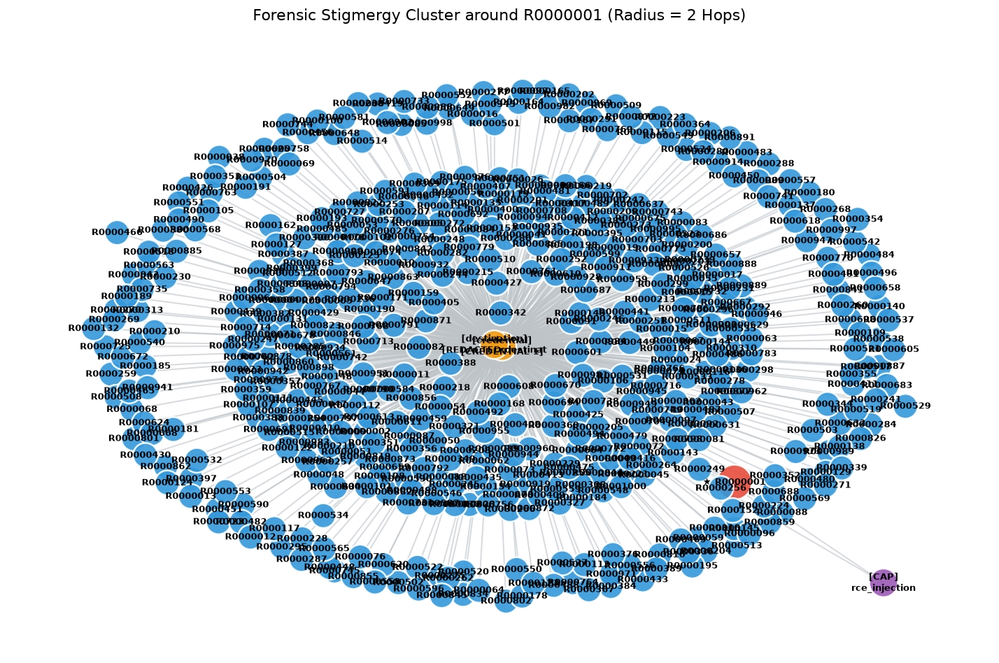

# TraceSentry

**TraceSentry: Provenance-Aware Oversight of Multi-Agent Attacks Through Stigmergic Coordination Detection**

TraceSentry is a provenance-aware oversight pipeline for reconstructing and detecting coordinated attacks in multi-agent systems, including cases where agent identities are redacted and coordination occurs through shared environmental state.

This repository contains the implementation used for the experiments in the accompanying paper.

---


---

## Quick Start

### 1. Clone the repository

```bash
git clone https://github.com/chillguycode/TraceSentry.git
cd TraceSentry
```

### 2. Download the dataset

Create the dataset directory and download the redacted Swarm Traces corpus:

```bash
mkdir -p dataset
cd dataset
curl -O https://swarmtraces.org/data/final/redacted.jsonl.gz
python -m gzip -d redacted.jsonl.gz
cd ..
```

The experiments expect the uncompressed file at:

```text
dataset/redacted.jsonl
```

### 3. Install dependencies

```bash
pip install -r requirements.txt
```

### 4. Run the full experiment pipeline

The experiments are intended to be run in this order:

```bash
python run_forensics.py
python run_benchmark_earlychecker.py
python run_ml_dataset_generator.py
python run_holdout_test_ml.py
python run_crossval_test_ml.py
```

`run_forensics.py` processes the entire trace corpus by default. Use `--limit N` only when you want to run a smaller subset.

---

## Experiment Workflow

Run the experiments in this order:

1. **Forensics**
   ```bash
   python run_forensics.py
   ```
   Reconstructs the provenance graph and identifies suspicious origins.

2. **Gateway benchmark**
   ```bash
   python run_benchmark_earlychecker.py
   ```
   Runs the Stage 1 gateway in `FULL_DPI` and `EGRESS_ONLY` modes.

3. **Build Stage 2 datasets**
   ```bash
   python run_ml_dataset_generator.py
   ```
   Produces the two feature CSVs used by the classifiers.

4. **Holdout evaluation**
   ```bash
   python run_holdout_test_ml.py
   ```
   Evaluates the five Stage 2 models on the 20% holdout set.

5. **Cross-validation**
   ```bash
   python run_crossval_test_ml.py
   ```
   Runs 5-fold cross-validation on the training partition.

In short:

```text
Raw traces → Forensics / Gateway → Stage 2 datasets → Holdout + Cross-validation
```

---

## Dataset

TraceSentry uses the redacted Swarm Traces JSONL corpus.

**Source dataset:**  
[Forman, A., Kharlov, M., Tom, W., Ladish, J., Kitts, S., Byrd, C. S., McKenzie, C., & Piecha, A. (2026). _Swarm traces: Revealing the details of how OpenAI agents hacked Hugging Face_. 25 September 2026.](https://swarmtraces.org/)

Expected repository layout:

```text
TraceSentry/
├── dataset/
│   └── redacted.jsonl
├── requirements.txt
├── run_forensics.py
├── run_benchmark_earlychecker.py
├── run_ml_dataset_generator.py
├── run_holdout_test_ml.py
└── run_crossval_test_ml.py
```

---

# Running the Experiments

## 1. Forensic Reconstruction

### Basic usage

```bash
python run_forensics.py
```

The default configuration processes the entire dataset.

### Run a subset

```bash
python run_forensics.py --limit 5000
```

A non-positive `--limit` means the entire dataset is processed. Since the default is `0`, you do not need to pass `--limit` for a full-corpus forensic run.

### CLI options

| Option | Default | Description |
|---|---|---|
| `--dataset PATH` | `dataset/redacted.jsonl` | Path to the uncompressed JSONL trace dataset. |
| `--limit N` | `0` | Number of records to process. Use `0` or a negative value for the entire dataset. |
| `--min-blast N` | `1` | Minimum blast radius required for a candidate to qualify as Patient Zero. |
| `--save-plot PATH` | `assets/graph.png` | Output path for the rendered forensic cluster visualization. |

### Examples

Run on a small subset:

```bash
python run_forensics.py --limit 5000
```

Run the full corpus and save the visualization elsewhere:

```bash
python run_forensics.py \
  --dataset dataset/redacted.jsonl \
  --min-blast 1 \
  --save-plot assets/forensic_graph.png
```

### What it does

The script:

1. Streams and parses the trace records.
2. Builds the provenance graph from payloads, infrastructure artifacts, and capabilities.
3. Ranks suspicious Patient Zero candidates.
4. Prints a ranked attribution report.
5. Renders a 2-hop provenance cluster around the highest-ranked candidate.

The visualization is written to the path supplied by `--save-plot`.

---

## 2. Stage 1 Gateway Benchmark

### Basic usage

```bash
python run_benchmark_earlychecker.py
```

With no arguments, the script runs **both `FULL_DPI` and `EGRESS_ONLY`** over the entire dataset. Because `--limit` defaults to `0`, no `--limit` option is needed for a full-corpus benchmark.

### CLI options

| Option | Default | Description |
|---|---|---|
| `--dataset PATH` | `dataset/redacted.jsonl` | Path to the uncompressed JSONL trace dataset. |
| `--limit N` | `0` | Number of records to process. `0` means the entire dataset. |
| `--mode MODE` | `BOTH` | Evaluation mode: `FULL_DPI`, `EGRESS_ONLY`, or `BOTH`. |

### Examples

Run only FULL_DPI:

```bash
python run_benchmark_earlychecker.py --mode FULL_DPI
```

Run only EGRESS_ONLY:

```bash
python run_benchmark_earlychecker.py --mode EGRESS_ONLY
```

Run a 10,000-record smoke test:

```bash
python run_benchmark_earlychecker.py --limit 10000
```

Use a custom dataset path:

```bash
python run_benchmark_earlychecker.py   --dataset /path/to/redacted.jsonl   --mode BOTH
```

### What it measures

The benchmark reports:

- total elapsed time
- average latency per event
- throughput
- events filtered on the fast path
- events escalated to Stage 2
- Stage 2 reduction ratio
- first alert sequence position
- early-warning lead time
- number of unique flagged IDs
- tainted-asset count
- rule attribution frequencies

`FULL_DPI` enables payload/checksum-derived inspection, while `EGRESS_ONLY` removes those body-derived checks and retains infrastructure/state-based signals.

---

## 3. Generate the Stage 2 ML Dataset

```bash
python run_ml_dataset_generator.py
```

This script has **no argparse CLI options** in the current implementation. Its input and output paths are defined inside the script.

It reads:

```text
dataset/redacted.jsonl
```

and generates:

```text
dataset/stage2_features_egress_only.csv
dataset/stage2_features_full_dpi.csv
```

The generator first resolves the confirmed attack IDs and pre-computes global artifact degrees, then streams the corpus through the Stage 1 gateway and exports features only for escalated events.

Each generated row contains eight Stage 2 features plus the target label:

```text
early_suspicion_score
newman_weight
artifact_degree
topological_gravity_bm25
topological_risk_nist
causal_depth
payload_char_len
is_stigmergic_reader
is_malicious
```

The EGRESS_ONLY dataset excludes checksum-derived candidates in accordance with the gateway ablation.

---

## 4. Stage 2 Holdout Evaluation

```bash
python run_holdout_test_ml.py
```

This script has **no argparse CLI options** in the current implementation.

It reads:

```text
dataset/stage2_features_egress_only.csv
dataset/stage2_features_full_dpi.csv
```

and performs an **80/20 stratified train/test split** with `random_state=42`.

The following models are trained and evaluated in both modes:

- Logistic Regression
- ANN / MLP
- Balanced Random Forest
- XGBoost
- TraceSentry soft-voting ensemble (Random Forest + XGBoost)

The experiment reports:

- Precision
- Recall
- F1-score
- PR-AUC
- inference latency per sample

The fitted models and scalers are saved under:

```text
checkpoints/holdout/
```

---

## 5. Five-Fold Cross-Validation

```bash
python run_crossval_test_ml.py
```

This script has **no argparse CLI options** in the current implementation.

It loads the same two Stage 2 datasets and reproduces the same stratified 80/20 training partition (`random_state=42`) used by the holdout experiment.

It then performs **5-fold stratified cross-validation** on the 80% training partition with `random_state=42`.

The script evaluates:

- Logistic Regression
- ANN / MLP
- Balanced Random Forest
- XGBoost
- TraceSentry soft-voting ensemble

It reports mean and standard deviation for F1-score across folds, together with mean precision and recall.

The cross-validation checkpoints are written to:

```text
checkpoints/crossval/
```

---

## Reproduction Order

For a clean reproduction from the raw trace dataset:

```bash
# 1. Full forensic reconstruction (forensics defaults to 5000; 0 means all rows)
python run_forensics.py --limit 0

# 2. Stage 1 gateway benchmark (full corpus by default)
python run_benchmark_earlychecker.py

# 3. Generate Stage 2 datasets
python run_ml_dataset_generator.py

# 4. Stage 2 holdout evaluation
python run_holdout_test_ml.py

# 5. 5-fold cross-validation
python run_crossval_test_ml.py
```

For a quick smoke test before the full run:

```bash
python run_forensics.py --limit 5000
python run_benchmark_earlychecker.py --limit 5000 --mode BOTH
```

The Stage 2 dataset generator and downstream ML experiments should be run after the Stage 2 CSV files have been generated.

---

## Output Files

A successful run produces or updates:

```text
assets/graph.png
dataset/stage2_features_egress_only.csv
dataset/stage2_features_full_dpi.csv
checkpoints/holdout/
checkpoints/crossval/
```

---

## Reproducibility Notes

The gateway benchmark is sequential and stateful: the checker updates its state only after scoring the current event.

The Stage 2 holdout and cross-validation experiments use fixed stratified splits with `random_state=42`.

The Stage 2 feature generator computes global artifact-degree statistics over the trace corpus before exporting the supervised-learning datasets. Therefore, the Stage 2 evaluation should be interpreted as the retrospective supervised evaluation described in the paper rather than as a fully causal online evaluation.

For detailed methodology, results, limitations, and interpretation, see the accompanying paper PDF.
